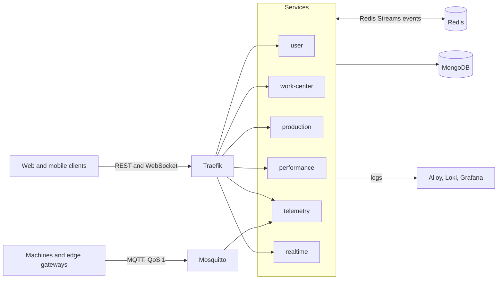

# AIMES

[](https://github.com/ulasdnz/aimes/actions/workflows/ci.yml)

AIMES is the backend of a Manufacturing Execution System that runs on a single server inside a
factory, with no cloud dependency. Machines report over MQTT; six Node.js/TypeScript services turn
those signals and the operators' input into production records, machine stops and OEE, and push
changes to the clients in real time.

## Highlights

- **No stop lost through an outage.** With telemetry disconnected for 30 minutes at 500 messages/s,
  the broker held 901,839 messages, telemetry caught up in 14 minutes, and 0 of 198 machine
  transitions were lost ([measured](docs/operations/mqtt-broker-capacity.md)).
- **Every write is audited.** In five services, 29 models record who changed what, when, from which
  IP and request trace, with the document before and after.
- **Query plans are tested.** List queries run under the MongoDB profiler in tests, which fail if a
  query stops using its compound index or sorts in memory.
- **Tests run on real infrastructure.** The suites (923 unit, 203 contract, 13 end-to-end) run
  against real MongoDB, Redis and Mosquitto in Testcontainers rather than in-memory fakes. The
  end-to-end run fails on any service crash or error log line, not only on failed assertions.
- **One command installs and upgrades a server**, online or without internet access, from
  versioned images that a release tag publishes.

## Architecture



| Service | Owns |
|---|---|
| `user` | Users, roles and permissions, sign-in (JWT), the system administrator |
| `work-center` | Work centers and their hierarchy, shifts and schedules, operators |
| `production` | Products, units, standards, production plans, job orders, quantity adjustments, scrap |
| `performance` | OEE (availability, productivity, quality), planned and unplanned stops, stop reasons, stops detected from the machines' run-mode signal |
| `telemetry` | Edge devices and tags, MQTT ingestion, the historian, tag discovery |
| `realtime` | The WebSocket gateway that pushes every service's events to the rooms of the work centers they concern |

A machine signal travels: device → Mosquitto → `telemetry` stores the sample and publishes
`tag.value.recorded` → `performance` opens or closes a stop → `realtime` pushes the change to the
clients watching that work center.

Shared code lives in [`packages/`](packages): error handling and request context, auth, cache,
events, health probes, logging, OpenAPI, the permission registry and test utilities.

## System design

### API and contracts

- REST with one response shape: `{ data }`, `{ data, message }` for writes, `{ data, pagination }`
  for lists and `{ error: { code, message, details? } }` for errors. As a rule, a state change is a
  field update through `PATCH`, not an action route.
- Request validation and the OpenAPI 3.1 document come from the same Zod schemas
  ([`packages/openapi`](packages/openapi/src/index.ts)), so the docs cannot drift from what the API
  accepts. Unknown fields are rejected, not ignored. In the user service a contract test checks that
  every route has an OpenAPI entry.
- Error codes are i18n keys; the message is translated per request (English and Turkish).
- Pagination caps the page size at 100 and skips the full count when there is no filter
  (`estimatedDocumentCount`). References are populated only when the client asks, from a whitelist.
- Instants travel as ISO 8601 UTC and are stored as `Date`; local time exists only in presentation.

### Gateway and security

- [Traefik](docker-compose.yml) routes each public resource to the service that owns it. A path no
  router names gets the gateway's 404, and `/internal/v1` is never routed: service-to-service calls
  use the internal network and a shared token of at least 32 characters.
- Per-IP rate limits: 200 requests/s in general, 30/s on sign-in. Request bodies are capped at
  25 MiB and responses are compressed.
- JWT authentication with role-based permissions: every route declares the permission it needs,
  and one registry ([`packages/privileges`](packages/privileges/src/index.ts)) lists them all; the
  system administrator's role syncs to it at every start.
- Sign-in locks an account for 5 minutes after 5 failed attempts. Passwords are bcrypt hashes.
- WebSocket clients authenticate in the handshake, so the token never appears in a URL or an access
  log. A client may only join the rooms of work centers it can see, and every event is checked
  against each receiving socket before delivery.
- MongoDB, Redis, Loki and the Traefik dashboard listen on `127.0.0.1` only; operators reach them
  through an SSH tunnel ([how](docs/operations/remote-database-access.md)).

### Data

- An [audit-log plugin](user/src/lib/plugins/audit-log.plugin.ts) records every create, update and
  delete with the user, IP, trace ID and the document before and after. Secrets are masked, and a
  failed audit write is logged without failing the request.
- Actor fields (`createdBy`, `updatedBy`) and timestamps on every model; IDs from another service
  are stored without a Mongoose `ref`, since that data lives in another database.
- Indexes are created on startup in production, and migrations run on boot in filename order,
  recorded so that each runs once.
- Concurrent updates use atomic operators (`$addToSet`, conditional updates) instead of
  read-modify-write.

### Caching

- Cache-aside with TTLs, and a singleflight layer: concurrent misses for the same key share one
  load instead of stampeding the database ([`packages/cache`](packages/cache/src)).
- The auth context (user, roles, permissions) is cached for 5 minutes and dropped as soon as a user
  or role changes.
- Redis runs with `noeviction`. Every key carries a TTL and every stream is trimmed, so memory stays
  bounded; an eviction policy could instead drop a stream entry or a pending stop decision without
  a trace.

### Event-driven communication

- Services publish to Redis Streams (`events.user`, `events.work_center`, `events.production`,
  `events.performance`, `events.telemetry`) and consume through consumer groups
  ([`packages/events`](packages/events/src)).
- Delivery is at least once: an entry is acknowledged only after its handler succeeds. Entries a
  crashed consumer left pending are reclaimed with `XAUTOCLAIM`, and an entry that fails five
  deliveries is set aside instead of blocking the stream.
- Events carry IDs, not documents, so a consumer always reads current state. When a job order moves
  to another work center, its event names the old one too, and both rooms hear about it.
- The request's trace ID travels inside every event and seeds the consumer's log context, so one
  ID follows a change across services.
- Redis Streams replaced a BullMQ job queue: one Redis instance already served the cache, and
  consumer groups covered every need without a second queueing system.

### IoT ingestion

- Telemetry keeps a persistent MQTT session (fixed client ID, `clean: false`, one-day expiry), so
  the broker queues the plant's messages while telemetry is down. The broker's queue ceiling and
  memory limit come from a measured load model, not from defaults.
- Intake is bounded: at 20 received and unstored messages, telemetry holds back the next
  acknowledgement, MQTT.js stops reading, and the backlog stays in the broker instead of in
  telemetry's memory. The bound was chosen by measuring throughput at 5, 10, 20, 100 and 1000.
- Samples of one tag are stored in order. A store that hits a transient MongoDB error waits and
  retries with backoff instead of dropping the sample.

### Real time

- [`realtime`](realtime/src/gateway/socket.ts) is a Socket.io gateway with a room per work center.
  WebSocket over Server-Sent Events, because clients switch rooms on the same connection and get an
  acknowledgement with the rooms they were allowed into, and because the token stays in the
  handshake rather than in an `EventSource` URL.

## Reliability

The goal for machine stops: none is lost while a service cannot answer for a while, and a stop
recorded late keeps the machine's own start and end times
([design](docs/superpowers/specs/2026-11-01-run-mode-outage-design.md)).

| Failure | What happens |
|---|---|
| Telemetry down or restarting | The broker queues messages for its persistent session; telemetry catches up at three times the arrival rate. |
| MongoDB unreachable | Telemetry retries the store and holds back acknowledgements, so the broker keeps the backlog. |
| Telemetry or work-center not answering performance | Pending stop decisions stay in Redis with the time they began and are retried; a decision made late uses the machine's times. |
| A consumer crashes mid-event | The entry stays pending and is reclaimed by the next consumer. |
| An outage longer than the queue ceiling | The broker drops and counts the overflow, and Grafana alerts on it; a lost MQTT session alerts too. |

Measured on 3 November 2026 with `pnpm test:capacity` (150-byte messages, services under their
compose limits):

| Rate | Outage | Queued messages | Broker peak memory | Telemetry caught up in | Transitions lost |
|---|---|---|---|---|---|
| 500 msg/s | 30 min 11 s | 901,839 | 610.1 MiB | 14 min 1 s | 0 of 198 |

The queue ceiling holds 37.6 minutes at 500 messages/s. Every setting, how it was derived and the
runs behind it are in [MQTT broker capacity](docs/operations/mqtt-broker-capacity.md).

## Observability

- Structured JSON logs with an `event` field on every line (`user.login.failed`,
  `mqtt.session.lost`, ...), and a trace ID from the HTTP request through every event it causes.
- Alloy ships container logs to Loki with two labels, `service` and `level`; Grafana alerts on
  broker drops and a lost MQTT session.
- Each service exposes `/health`, `/health/live` and `/health/ready`; readiness checks MongoDB and
  Redis, and compose starts a service only after its dependencies are healthy.
- Graceful shutdown: on `SIGTERM` a service stops taking new work and closes its connections within
  a time limit; `dumb-init` passes the signal on as PID 1.

## Testing

| Suite | Runs against | Count |
|---|---|---|
| Unit | Real MongoDB in Testcontainers, and a real Redis where the code uses one | 923 |
| Contract | Each service's HTTP API and events, against real MongoDB and Redis | 203 |
| End-to-end | The built services, started together against real MongoDB, Redis and Mosquitto | 13 |
| Capacity | The broker and telemetry through a 30-minute outage | on demand |

- Real infrastructure over fakes: a test that passes against a fake but would fail against the
  real thing hides a production bug. Calls to other services are stubbed at their HTTP client.
- List queries are profiled in tests, which assert the index used (`IXSCAN`) and the absence of an
  in-memory sort ([helper](packages/testing/src/profile.ts)).
- The end-to-end harness fails the run when any service crashes or logs an error line, even if
  every assertion passed.
- CI on pushes to `main` and on pull requests: Biome, type checking of source and tests, a
  production dependency audit, then the unit, contract and end-to-end suites
  ([workflow](.github/workflows/ci.yml)).

## Delivery

- Multi-stage Dockerfiles on a digest-pinned Node 26 Alpine image: `pnpm deploy --prod` copies only
  runtime dependencies, the service runs as a non-root user under `dumb-init`, and the image holds
  no package manager.
- Dependabot moves the pinned base and infrastructure images and the action SHAs monthly, after a
  7-day cooldown.
- A `vX.Y.Z` tag runs the [release workflow](.github/workflows/release.yml): it publishes the six
  images to GHCR, refuses a version that already exists, and attaches the install package.
- [`install.sh`](install.sh) installs and upgrades a server: it fills every empty secret with a
  random value, never changing one already set, loads or pulls the version's images and waits until
  every service is healthy. An offline package carries the images for a plant without internet
  access ([installation](docs/operations/installation.md)).

## Local development

Requirements: Docker, Node.js 26 and pnpm 10.

```bash
pnpm install
SYSTEM_ADMIN_PASSWORD='<8 to 20 characters>' ./install.sh   # builds and starts the full stack
```

To work on the services from source, start only the infrastructure and run the services in watch
mode. `install.sh` has filled the root `.env` by then; copy each service's `.env.example` to
`.env` first.

```bash
docker compose up -d mongodb redis mosquitto
pnpm dev
```

```bash
pnpm typecheck        # source and tests
pnpm lint             # Biome
pnpm test             # unit
pnpm test:contract    # contract
pnpm test:e2e         # end-to-end
```

## Trade-offs and next steps

- **One server by design.** A plant runs one box, so Docker Compose and an install script fit
  better than Kubernetes. Running several instances of a service would need the Socket.io Redis
  adapter, which Redis already makes possible.
- **No TLS at the gateway yet.** Traffic stays on the plant network; the first step for a customer
  install is TLS termination at Traefik with the plant's certificate.
- **No transactional outbox.** A write whose event fails to publish is kept and the failure is
  logged; an outbox would make the event as durable as the write.
- **No multi-document transactions.** Deleting a role and removing it from users are two writes.
- **The audit plugin covers single-document operations** (`save`, `findOneAndUpdate`,
  `findOneAndDelete`), not bulk updates.
- **Traefik reads the Docker socket** to discover services; a socket proxy would narrow that access.

## Tech stack

Node.js 26, TypeScript 5, Express 5, Zod 4 with zod-openapi, Mongoose 9 on MongoDB 9, ioredis 5 on
Redis 7 (cache and Streams), MQTT.js 5 on Mosquitto 2, Socket.io 4, Winston, i18next, Traefik 3,
Grafana, Loki and Alloy; Vitest 4 with Testcontainers; pnpm workspaces, Turborepo, Biome and GitHub
Actions.
